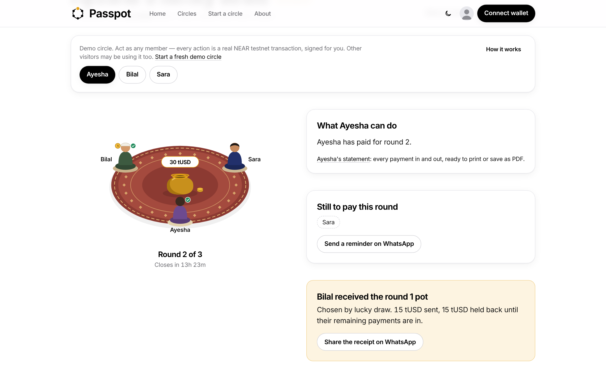
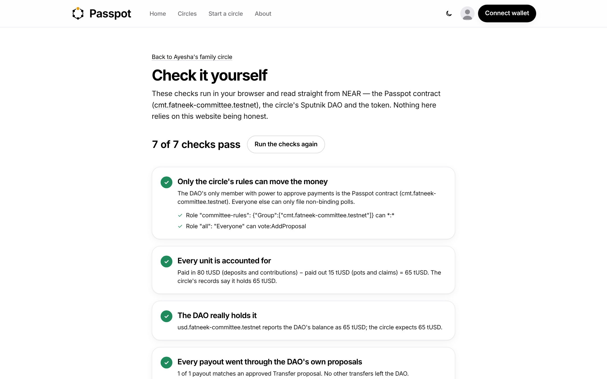
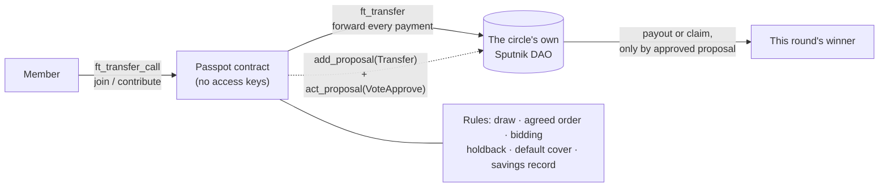

<p align="center">
  
</p>

<h1 align="center">Passpot</h1>

<p align="center"><b>The savings circle nobody can run off with.</b> A rotating savings circle (ROSCA) on NEAR, where the pot sits in its own DAO and pays out by rule.</p>

<p align="center">
  <a href="https://passpot.vercel.app"></a>
  <a href="https://testnet.nearblocks.io/address/cmt.fatneek-committee.testnet"></a>
  <a href="#tests"></a>
  <a href="LICENSE"></a>
</p>

<p align="center">
  <a href="https://x.com/Fatneek117/status/2120447478705074247"><b>▶ Watch the 2-minute demo</b></a> ·
  <a href="https://passpot.vercel.app/demo">Try a demo circle, no wallet needed</a>
</p>

<p align="center">
  
</p>

A group of people each pay the same amount every round, and one member receives the whole pot each round until everyone has had a turn. The same arrangement is called a committee in Pakistan and India, a susu in Ghana, a tanda in Mexico, a chama in Kenya and a hui in China.

Built at NEAR HACKATHON for the **Social Money** and **Real-World Money** tracks.

- **Live app:** https://passpot.vercel.app (NEAR testnet)
- **Passpot contract:** [`cmt.fatneek-committee.testnet`](https://testnet.nearblocks.io/address/cmt.fatneek-committee.testnet) (locked: it has no access keys, so its code can never be changed. Check it on any circle's Verify page.)
- **Test-dollar token (testUSD):** [`usd.fatneek-committee.testnet`](https://testnet.nearblocks.io/address/usd.fatneek-committee.testnet)

## The problem

In a normal circle the organizer holds the cash and the record is a notebook. Three things go wrong:

1. The organizer can disappear with the money.
2. A member who gets the pot early can stop paying, and the members still waiting lose out.
3. Nobody can prove who paid or how the winner was chosen.

## What Passpot does about it

| Problem | What the code does | Where |
| --- | --- | --- |
| The organizer holds the cash | Each circle can get its own **Sputnik DAO** (via `sputnikv2.testnet`). The Passpot contract is the DAO's only council member. Payments are forwarded into the DAO, and money leaves only through DAO Transfer proposals the contract files and approves when the rules say so. | `contracts/committee/src/lib.rs`: `create_committee`, `forward`, `send` |
| An early winner stops paying | Part of an early winner's pot is **held back** and released round by round as they keep paying. A missed payment is covered first from holdback, then from the member's deposit. | `contracts/committee/src/core.rs`: `advance`, `holdback_bps_for` |
| Who gets the pot can be rigged | Three payout modes: an **on-chain lucky draw** from NEAR's random seed (the seed is stored, so anyone can replay it), an **agreed order**, or **bidding**, where a member offers a discount to get the pot sooner and the discount is shared with the others. | `core.rs`: `choose`, `place_bid` |
| Trust doesn't carry over | A **savings record** per account: clean circles finished, circles with a miss, on-time and missed payments. It sets the holdback (50% for new members, 25% after one clean circle, 0% after three) and can **gate who joins**: an organizer can require joiners to have 1 or 3 clean circles and no missed circles. | `lib.rs`: `reputation`, `check_join_rule` |
| Nobody can prove what happened | Every payment, payout, bid and draw is an event in the circle's on-chain history. The **Verify** page re-checks the vault balance, the DAO policy, every payout proposal and every draw in the browser, straight from RPC. | `web/src/lib/verify.ts` |

Profiles (name, city, what the member is saving for) are stored on **NEAR Social** under the member's own account.

### Beyond "the contract holds the pot"

A contract holding the money stops the organizer running off. Passpot also covers the other ways circles break:

| What goes wrong | A basic on-chain circle | Passpot |
| --- | --- | --- |
| An early winner stops paying | The members still waiting lose out, or vote on it | Holdback released round by round; a miss is covered automatically from holdback, then deposit |
| Arguing over who goes first | One fixed order | Replayable lucky draw, agreed order, or bidding with the discount shared |
| The money loses value | Paid in a coin whose price moves | Paid in dollars (testUSD here, USDC on mainnet) |
| Strangers can't be trusted | Everyone joins on equal terms | A savings record sets the holdback and can gate who joins |
| Proving it's safe | Read the explorer | Verify page re-checks the DAO, the balances, every payout and draw, and that the contract has no keys |
| Trying it out | Connect and fund a wallet | One-click demo circle, no wallet |

## Try it (no wallet needed)

1. Open https://passpot.vercel.app and click **Try a demo circle**.
   You see a live circle that three demo members (Ayesha, Bilal and Sara) are part of. Every action is a real testnet transaction, signed on the server with testnet-only demo keys.
2. Under "Act as", pick a member who hasn't paid this round yet and click **Pay 10 tUSD**.
   You see a green tick next to that member in the register and a "… paid" notice with a link to the transaction.
3. For a full round from scratch, open https://passpot.vercel.app/demo?fresh=1 and click **Set up the demo circle**.
   You see the six setup steps run one by one (create circle and DAO, join, start), then the circle page.
4. Pay as Ayesha and Bilal, but not as Sara. When the 90-second round ends, click **Close round and run the draw**.
   You see Sara marked **Covered** in the register (her deposit paid her share), the pot passing to the winner in the illustration, and a "DAO paid … through proposal #N" line in Activity.
5. Click **Verify on-chain** at the top of the circle.
   You see every check pass (7 for a DAO circle), including that nobody holds a key to the Passpot contract, that the DAO's only voting member is the Passpot contract and that the DAO's token balance matches what the circle expects.

<p align="center"></p>

### With your own wallet

1. Click **Connect wallet** and choose **Meteor Wallet** (create a testnet account there). A new account needs a little test NEAR for fees: https://near-faucet.io.
2. Click **Get test dollars** in the top bar. You see your balance go up by 1,000 tUSD.
3. Click the avatar in the top bar to **make your profile**. You see it on your profile page, saved to NEAR Social.
4. Go to **Start a circle**, choose a setup, and pick who can join. After creating it, you see a "Your circle is live" banner, an **Invite on WhatsApp** link, and your seat waiting to be taken.
5. **Your money** (top bar) lists what you owe this round, money locked as cover, and pots coming to you, with **Google Calendar** and **Apple / Outlook** reminders for each due date.

## How the money moves



1. **Create.** The organizer attaches 6 NEAR (the Sputnik factory's storage price). The contract asks the factory for a DAO whose only council member is the contract. The policy is public via `get_dao_policy`. Without the deposit, the contract itself holds the circle's money (for quick tests).
2. **Join.** Each member locks one contribution as a deposit: `ft_transfer_call` with `{"action":"join","committee_id":N}`. If the circle has a join rule and the sender's record doesn't meet it, the call panics and the token contract refunds them.
3. **Pay.** Each round: `{"action":"contribute","committee_id":N}`. Payments are forwarded to the DAO.
4. **Close the round.** Anyone can call `advance_round` once everyone has paid or the round's time is up. The contract covers misses, picks the recipient, files a Transfer proposal on the DAO and approves it.
5. **Claim.** After the last round, members take back their deposit, remaining holdback and their share of bid discounts, also through DAO proposals.

Failures partway through (a transfer, a forward, the DAO's reply) are recorded and can be retried by anyone: `retry_payout`, `retry_forward`, `recheck_dao`.

## The agent

`web/src/app/api/agent` closes any round whose time is up, in every circle, and keeps one demo circle running with a round in progress. It is called by a GitHub Actions schedule (`.github/workflows/agent.yml`, set to every 5 minutes; GitHub runs scheduled jobs less often than that on new repositories) and by Vercel Cron once a day. Closing a round needs no special rights: anyone can call `advance_round`, and the circle page shows a **Close round** button to everyone once time is up.

## Repository

| Path | What it is |
| --- | --- |
| `contracts/committee` | The Passpot contract (Rust, near-sdk 5). `src/core.rs` holds every circle rule with no blockchain code, so the rules are unit-tested directly. `src/lib.rs` is the NEAR side: token payments, Sputnik DAO custody, callbacks, reputation, join rules. |
| `contracts/testusd` | testUSD, a NEP-141 test token (6 decimals) with a public `faucet()`. |
| `web` | The Next.js app: home, circles list, circle page, Verify, statements, profiles, Your money, Start a circle, About, the no-wallet demo and the agent API. |
| `web/scripts/test-modes.mjs` | End-to-end check on testnet: runs a full agreed-order circle and a full bidding circle with the demo accounts and checks who received each pot. |
| `scripts` | PowerShell scripts for testnet: `deploy.ps1`, `upgrade.ps1`, `dao-test.ps1`, `smoke-test.ps1`, `setup-demo.ps1`. |

## Tests

```
cargo test
```

35 unit tests (31 for the Passpot contract, 4 for testUSD): full circles in every payout mode, conservation of money, holdback and default cover, bidding, join rules, rejected payments, and the DAO flow including failure and retry paths.

End to end on testnet (needs `web/.env.local` with `DEMO_ACCOUNTS`):

```
cd web
node scripts/test-modes.mjs
```

## Run your own copy (testnet)

Needs Rust with the `wasm32-unknown-unknown` target, [cargo-near](https://github.com/near/cargo-near), [near-cli-rs](https://github.com/near/near-cli-rs), and a testnet account with about 20 NEAR.

```
.\scripts\deploy.ps1 -Account your-name.testnet      # testUSD + Passpot
.\scripts\setup-demo.ps1 -Account your-name.testnet  # demo members for the website
cd web
cp .env.example .env.local                          # contract names; setup-demo.ps1 adds DEMO_ACCOUNTS
npm install
npm run dev
```

On Vercel: Root Directory `web`, environment variables `DEMO_ACCOUNTS` and `CRON_SECRET`. For the scheduled agent, add GitHub secrets `ROTA_URL` (the site's URL) and the same `CRON_SECRET`.

## Limits

- **Testnet only.** testUSD has no value. Mainnet would use a real stablecoin and needs an audit first.
- **Holdback and deposits reduce default risk; they don't remove it.** A member who misses more than their holdback and deposit leaves a shortfall in that round's pot. It is recorded on-chain and on their savings record.
- **The lucky draw uses NEAR's block random seed.** Fair enough for a savings circle, but a block producer could in theory influence it.
- **Demo members are signed by the website's server** with testnet-only keys, so judges can try it without a wallet. The server only signs calls to the Passpot contract and testUSD.
- **NEAR Intents** (paying in from other chains) is on the roadmap, not built.

## Built with

Rust and near-sdk 5.30, cargo-near, Sputnik DAO v2 (`sputnikv2.testnet`), NEAR Social (`v1.social08.testnet`), Next.js 16, React 19, Tailwind CSS 4, near-api-js 7, NEAR Wallet Selector 10 (Meteor, Intear, HERE), Inter (via Fontsource), Playwright (for the demo video).

**AI assistance:** most of the code, copy and the demo video were written with Claude (Anthropic) as a coding assistant, directed and tested by the author. The demo video's voiceover is generated with the open-source Kokoro text-to-speech model.

All code was written during the hackathon window.

## Roadmap

- Pay in from any chain with NEAR Intents, so family abroad can pay a member's share directly.
- Swap turns: two members of an agreed-order circle trade payout rounds when both approve.
- Pay ahead: cover several rounds in advance.
- Real stablecoins (USDC) on mainnet after an audit.
- Urdu and Arabic interface; WhatsApp reminders before due dates.

## License

MIT, see [LICENSE](LICENSE).
